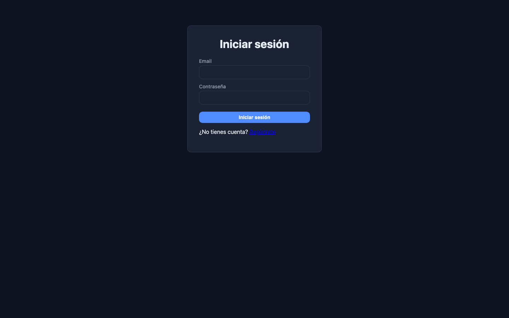

# 🏋️ FitTrack

> Full-stack fitness tracking app — log workouts, build routines, and visualize your progress.


FitTrack is a complete gym-tracking application: JWT authentication, an exercise library, workout session logging, reusable routine templates, and statistics with interactive charts — all deployed with Docker Compose.



## ✨ Features

- **🔐 Authentication** — register/login with JWT (Spring Security, BCrypt, stateless sessions)
- **🏋️ Exercise library** — personal CRUD of exercises with muscle groups and categories
- **📝 Workout logging** — sessions with multiple exercises, sets/reps and notes
- **📋 Routine templates** — save reusable routines, edit them, and start a session from a template in one click
- **📊 Statistics & charts** — streaks, weekly volume, and per-exercise weight progression (parsed from workout notes)
- **🐳 One-command deploy** — full stack with Docker Compose (Postgres + Spring Boot + nginx)

## 🛠️ Stack

| Layer | Tech |
|---|---|
| Frontend | React 19 + TypeScript, Vite, TanStack Query, React Router, Recharts |
| Backend | Java 21, Spring Boot 3, Spring Security, Spring Data JPA |
| Database | PostgreSQL 17 + Flyway migrations |
| Infra | Docker Compose, multi-stage builds, nginx (SPA + API proxy) |
| CI | GitHub Actions (backend compile + frontend build on every push/PR) |

## 🏗️ Architecture

```
Browser → localhost:8081 (nginx)
            ├── /        → React SPA (static)
            └── /api/*   → Spring Boot :8080 → PostgreSQL
```

```
fittrack/
├── backend/                  # Java 21 + Spring Boot 3 (Maven)
│   └── src/main/java/com/fittrack/
│       ├── config/           # Security (JWT filter, CORS)
│       ├── controller/       # REST controllers
│       ├── service/          # Business logic
│       ├── repository/       # Spring Data JPA
│       ├── model/            # JPA entities
│       └── dto/              # Request/response records
├── frontend/                 # React + TypeScript (Vite)
│   └── src/
│       ├── api/              # Typed API client
│       ├── components/       # Charts (Recharts)
│       ├── pages/            # Login, Register, Exercises, Workouts, Routines
│       └── hooks/            # Auth hooks
├── docs/                     # End-to-end test scripts (node)
└── docker-compose.yml
```

## 🚀 Quick start

### Option 1: Full stack with Docker

```bash
docker compose up -d
```

- **App:** http://localhost:8081
- **API:** http://localhost:8081/api (proxied by nginx)
- **PostgreSQL:** localhost:5432 (fittrack/fittrack)

### Option 2: Local development

```bash
# 1. Database only
docker compose up -d db

# 2. Backend (Java 21 + Maven)
cd backend && mvn spring-boot:run

# 3. Frontend (Node 18+)
cd frontend && npm install && npm run dev
```

- Frontend dev server: http://localhost:5173
- Backend: http://localhost:8080

## 🔑 API overview

| Method | Endpoint | Description |
|---|---|---|
| POST | `/api/auth/register` | Create account |
| POST | `/api/auth/login` | Get JWT |
| GET/POST/DELETE | `/api/exercises` | Exercise library CRUD |
| GET/POST/DELETE | `/api/workouts` | Workout sessions |
| GET | `/api/workouts/stats` | Streaks & weekly stats |
| GET | `/api/workouts/volume` | Daily volume (last 8 weeks) |
| GET | `/api/workouts/progression/{exerciseId}` | Weight progression per exercise |
| POST | `/api/workouts/from-routine/{routineId}` | Start session from routine |
| GET/POST/PUT/DELETE | `/api/routines` | Routine templates CRUD |

All endpoints (except auth) require the `Authorization: Bearer <token>` header.

## 🧪 End-to-end tests

The `docs/` folder contains runnable smoke tests that exercise the full API (auth → CRUD → stats → cleanup):

```bash
node docs/test-auth.mjs        # register + login + wrong password
node docs/test-exercises.mjs   # exercise CRUD
node docs/test-workouts.mjs    # sessions + stats + volume
node docs/test-routines.mjs    # routine templates
node docs/test-edit-routine.mjs
node docs/test-from-routine.mjs
node docs/test-progression.mjs
```

## 🗄️ Database schema

Managed with Flyway (3 migrations):

- `users` — accounts (BCrypt passwords)
- `exercises` — personal exercise library
- `workout_sessions` / `workout_exercises` — sessions and their exercises
- `routines` / `routine_exercises` — reusable templates

## 📄 License

MIT
